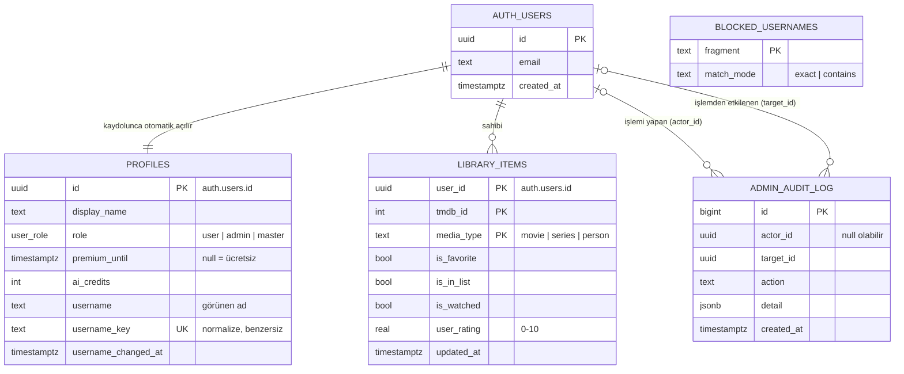

# Varlık-İlişki Diyagramı

Bu depodaki tabloların ilişkileri. GitHub bu diyagramı otomatik olarak çizer.

## Kurallar özeti

| Tablo | Okuma | Yazma |
| --- | --- | --- |
| `profiles` | Kendi satırı; yöneticiler hepsi | Kendi satırı. Rol: sadece master. Premium: sadece yönetici. Kullanıcı adı: sadece RPC |
| `library_items` | Kendi satırları | Kendi satırları |
| `admin_audit_log` | Sadece yöneticiler | Sadece sunucu |
| `blocked_usernames` | Herkes | Sadece sunucu |
